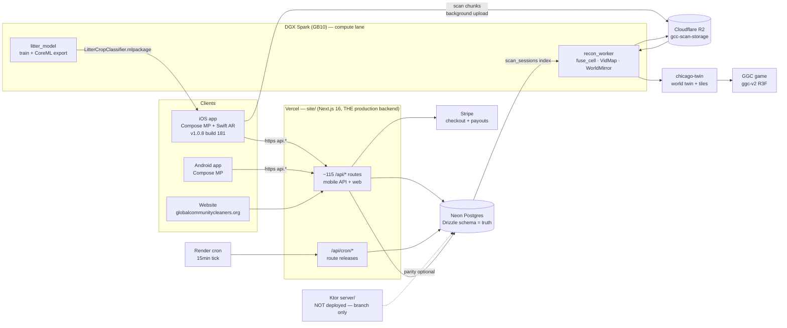
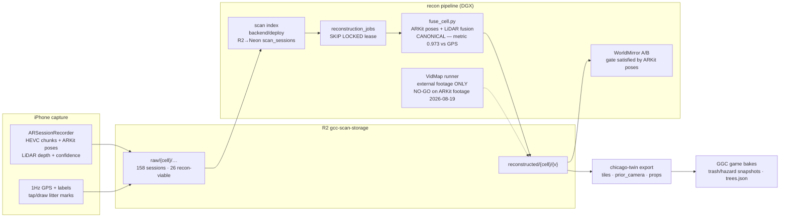
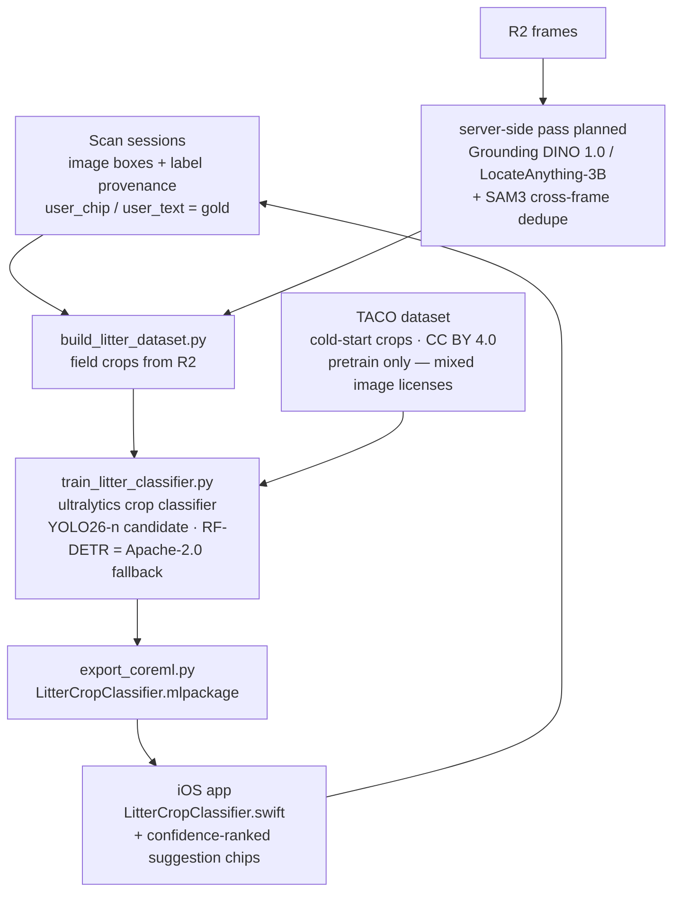
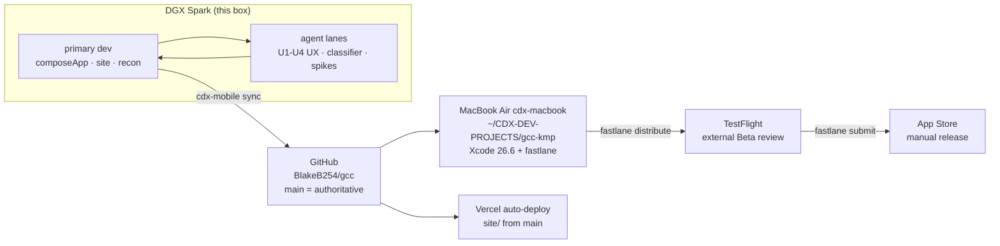
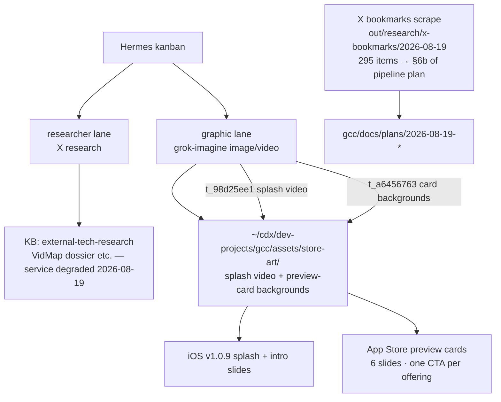

# GCC — Architecture Maps (Mermaid)

**Compiled:** 2026-08-19 · **Scope:** the whole GCC ecosystem as built — app, site, data, scan→recon→world-twin pipeline, release machinery, and the CDX platform lanes that feed it.
**Companion to:** doc #1 (production topology truth). This doc is the **visual layer** — read #1 for the canonical Next.js-vs-Ktor ruling.

## 1. System context — what runs and talks to what

**Truths to hold onto:** the mobile API **is** the Next.js app (Ktor is not deployed); Drizzle migrations own the schema; R2 raw scans are never deleted; recon outputs are versioned per cell with provenance.

## 2. Scan → reconstruction → world twin lifecycle

**2026-08-19 evidence:** ARKit sidecar poses fit GPS at scale 0.973 / 3.4 m median residual — ARKit + LiDAR fusion (`fuse_cell.py`) is the canonical geometry path; VidMap diverged ~30 m on the same frames and is scoped to non-ARKit footage (Ray-Ban, third-party video). `build_ios_bundle.py` (data/vidmap-p0) converts any R2 scan into a runner bundle in one command.

## 3. Litter identification flywheel

Every field confirmation is a training sample; the model shrinks manual labeling each cycle. On-device detector license ruling (2026-08-19): Ultralytics is AGPL — **RF-DETR (Apache-2.0) is the long-term pick** for the closed-source app; YOLO26 acceptable only if AGPL terms are embraced.

## 4. Build & release topology

`cdx-mobile` (sync/build/fetch) is the remote orchestrator; the release runbook is `docs/release/appstore-distribution.md`. v1.0.9 contents: scan-flow fixes F1–F9, intro carousel, first-block tutorial, splash v2 (video shell + Imagine asset), litter classifier bundled.

## 5. CDX platform lanes feeding GCC

## 6. Where the plans live

| Doc | Covers |
|---|---|
| `docs/plans/2026-08-19-scan-to-world-pipeline-and-ios-release-plan.md` | End-to-end scan→twin pipeline, trash-ID stack, VidMap verdict, iOS v1.0.9 release plan, bookmark integrations (§6b), work order |
| `docs/plans/2026-08-19-ios-ux-onboarding-splash-preview-cards.md` | UX inspection findings, flow fixes F1–F9, intro carousel, first-block tutorial, splash v2, store preview cards |
| `chicago-twin/docs/vidmap-p0-findings-2026-08-19.md` (+ addendum) | All three VidMap spikes, metrics tables, ARKit tiebreak |
| `gcc/data/vidmap-p0/` | `build_ios_bundle.py`, `diagnose_bundle.py`, bundles, `.venv` |
